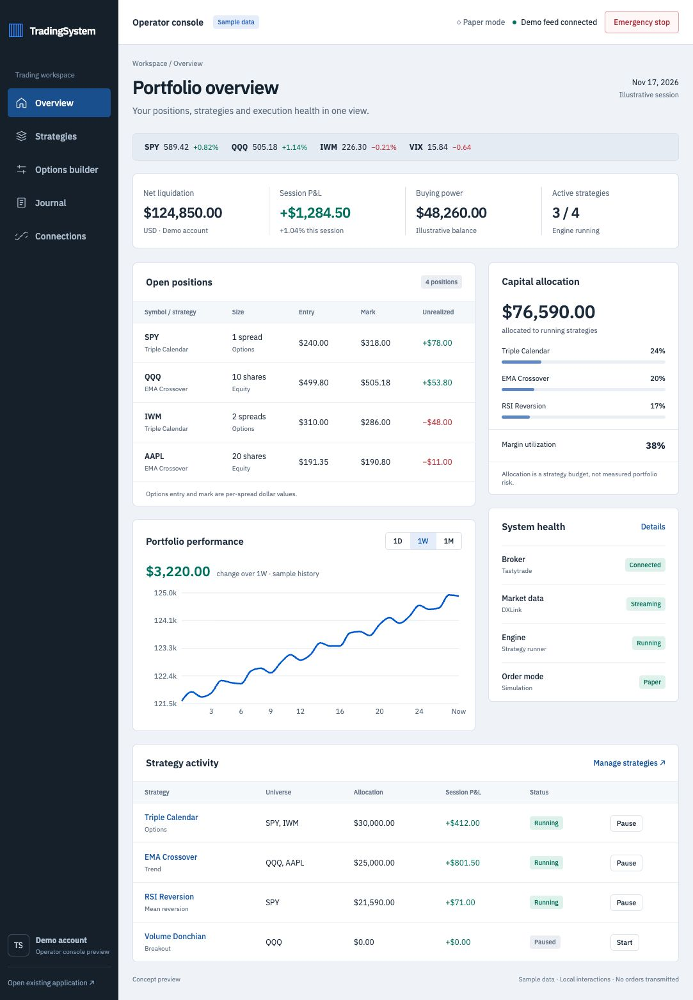

# Multi-Strategy Automated Trading System (Alpaca paper orders, Tastytrade data)

Runs trading strategies with **orders routed to an Alpaca paper account** (paper-locked in
code; live Alpaca is a deliberate future code change) and **Tastytrade for market data
only** (quotes, option chains, history; OAuth personal grant). The Alpaca paper account
may be shared with other tools: the app only touches orders it tagged (`tsys-`
client_order_id). Includes a live engine, dashboard, journal, equity backtests and an
options Builder (paper-tracked, never places orders). The Strategies tab lists the QQQ
first-hour credit spread and SPY 0DTE iron fly, alongside the XSP history archive. Runs as a local web app, a macOS
LaunchAgent service, or a hosted Docker stack.

## Architecture

```
backend/   FastAPI + async SQLAlchemy + httpx (Alpaca) + tastytrade SDK (data)
  app/
    config.py            env-driven settings (APCA_* Alpaca keys, Tastytrade OAuth creds)
    auth/                connection-state auth (authenticated == Tastytrade OAuth probe verifies)
    broker/              Alpaca paper orders (paper lock, tsys- tag), app-owned ledger, account
    engine/              kill-switch task registry, per-strategy workers, execution, recovery
    strategies/          BaseStrategy + registry (QQQ credit spread listed, switched off;
                         other slots Coming Soon)
    backtest/            pure-Python metrics + historical runner
    services/            market status/overview, logging + journal/calendar
    routers/             dashboard, strategies, journal, websocket
    db/                  models + async engine (SQLite dev / Postgres prod)
  tests/                 kill switch, journal, strategy gating, worker, backtest
frontend/  React + Vite + Recharts — the operator console (see "Frontend" below)
  src/
    App.jsx              shell: navigation rail, toolbar, emergency stop, banners
    components/          Dashboard, StrategiesTab/StrategyDetail, BuilderTab (+ builder/),
                         CalendarTab (journal), ApiTab (connections), shared widgets
    operator.css         operator console design system (layout, panels, tables, charts)
    redesign/            standalone sample-data concept preview (never calls the API)
docker-compose.yml       postgres + backend (serves the built UI) + caddy
```

## Frontend: operator console



<sub>Screenshot of the concept preview (`redesign.html`, sample data). The real app uses the
same layout, filled with live data from the API.</sub>

The UI is a dark navigation rail with a light workspace. A persistent toolbar shows feed
status, paper/simulated order mode, the data and broker sources, and the **Emergency
stop**. Recovery (safe mode) and connection banners appear above every screen.

| Screen | What it shows |
| --- | --- |
| **Overview** | Market board, Alpaca paper account metrics, app-owned positions, strategy activity, allocation budgets, system health |
| **Strategies** | Strategy table plus detail, allocation, activation and backtest workflows |
| **Options builder** | Analysis workspace (quote, payoff, Greeks, IV smile) and a trade setup panel with templates and stock/option legs; **Build \| Trades** toggle for paper-tracked trades and portfolio P&L |
| **Journal** | Month calendar of sessions with per-day session detail |
| **Connections** | Tastytrade market data, Alpaca paper, access token and order-routing settings |

Notes:

- **Real data only.** The main app shows no sample figures or mock charts. Missing account
  values show as dashes, and stale snapshots are labelled. Allocation bars are strategy
  budgets, not measured risk.
- **The UI is not the safety layer.** Order routing, activation, resume and emergency stop
  keep their confirmation dialogs, and the backend still enforces every check.
- **The access token** is entered in Connections and stored in the git-ignored
  `backend/.env`. It is never bundled into the frontend.
- **Responsive:** each main screen works at 390px width without horizontal scrolling.

### Concept preview (sample data)

`frontend/redesign.html` is a standalone, sample-data version of the design. It runs on
browser-local state, resets on reload and never calls the broker or app APIs. Screenshots
of all five screens are in `frontend/redesign-preview/`.

```bash
cd frontend
npm run dev -- --host 127.0.0.1 --port 5174   # open http://127.0.0.1:5174/redesign.html
npx vite build --config redesign.config.js    # builds to frontend/dist-redesign
```

## Key guarantees

- **Auth == Tastytrade OAuth probe verifies** — "authenticated" means the token-refresh
  probe against Tastytrade succeeds (see `app/broker/status.py`); the gated REST/WebSocket
  routes pass while it does. There is **no per-user login**. This is fine for a local
  browser tool, but anything network-exposed MUST sit behind the Docker stack's Caddy
  Basic Auth + TLS (see the hosted section below).
- **"Coming Soon" is enforced server-side** — activation, capital allocation, and backtest are
  rejected with `409` for not-ready strategies. The UI hiding is cosmetic only.
- **Orders go to Alpaca paper only** — `ENABLE_LIVE_ORDERS` ON (default) = tagged orders to
  `https://paper-api.alpaca.markets`; OFF = simulated fills, no order sent. Even when ON,
  every write is refused unless both Alpaca paper keys are set and `APCA_API_BASE_URL` is
  the paper host. Live (real-money) Alpaca is locked in code. No code path sends orders to
  Tastytrade.
- **Kill switch is real** — cancels every tracked async worker (even if flatten throws), is
  idempotent, and reports partial failure (`fully_flat`). Flatten cancels and closes only
  the app's own (`tsys-`) orders and quantities on the shared Alpaca account.

## Run locally (no Docker)

Backend (boots with zero infra — SQLite). Put the Alpaca paper keys in `backend/.env`
(`APCA_API_KEY_ID`, `APCA_API_SECRET_KEY`; `APCA_API_BASE_URL` defaults to
`https://paper-api.alpaca.markets`) for orders, and the Tastytrade OAuth provider secret +
refresh token for market data; the API tab shows both connections:

```bash
cd backend
../.venv/bin/pip install -r requirements.txt
../.venv/bin/python -m uvicorn app.main:app --port 8000
```

Frontend:

```bash
cd frontend
npm install
npm run dev   # operator console at http://localhost:5173  (talks to backend on :8000)
npm run build # production build to frontend/dist (served by run_web.sh and Docker)
```

## Run as a web app (browser)

One command builds the React UI and serves it together with the API from a single
uvicorn process, then opens it in your browser — no native window, no separate dev server:

```bash
./scripts/run_web.sh          # serves http://127.0.0.1:8765 and opens it
```

It binds to `127.0.0.1` (local machine only). For LAN access change `--host` to `0.0.0.0`
in the script —
**local network only; do not expose to the internet without adding real auth + TLS** (see
`docs/superpowers/specs/2026-06-26-web-app-migration-design.md`).

## Run as a background service (macOS LaunchAgent)

`com.tradingsystem.web` runs the same server as `run_web.sh` (API + built UI on
`http://127.0.0.1:8765`) at login, and restarts it if it exits:

```bash
./scripts/install_autostart.sh     # write + load ~/Library/LaunchAgents/com.tradingsystem.web.plist
./scripts/uninstall_autostart.sh   # stop + remove it
launchctl kickstart -k gui/$(id -u)/com.tradingsystem.web   # restart after code changes
```

To open it from a phone or another device on the same Wi-Fi, install it in LAN mode and
browse to the Mac's address (e.g. `http://<mac>.local:8765`):

```bash
RUN_WEB_HOST=0.0.0.0 ./scripts/install_autostart.sh
```

LAN mode is plain HTTP and the dashboard's read views have no login, so anyone on the
network can see account and position data. Gated actions (activate, kill, order routing)
still need `APP_AUTH_TOKEN`, which each device stores separately (paste it in Connections).
Never port-forward this to the internet; use the Docker stack below for remote access.
Re-running the install script without `RUN_WEB_HOST` switches back to this Mac only.

Logs go to `~/Library/Logs/trading-system.{out,err}.log`. The plist doesn't set
`ENABLE_LIVE_ORDERS`; order routing follows `backend/.env` (default ON = Alpaca paper when
keys are set). Re-run the install script
after moving the repo. Rebuild the UI (`cd frontend && npm run build`) before restarting so
the service serves your frontend changes.

## Strategies

**QQQ First-Hour Credit Spread** (`qqq_credit_spread`) runs **in this app on the Alpaca
paper account**; Tastytrade supplies market data only. Code:
`backend/app/strategies/qqq_credit_spread/`. Its entry and close rules are a port of the
external runner (`~/live_system_maintenance/live`, `com.karan.spreadlive`), checked for
parity against that runner's own functions (`backend/tests/test_qqq_spread_logic.py`).
Unlike the runner it has **no ML model**: every spread is held to the 15:50 flat exit.

- **10:30 ET entry.** Reads the completed first hour (Tastytrade 1-minute candles): green
  sells a $1 put spread, red a call spread, flat skips. The limit credit is the live option
  mid, re-priced every 15 s (cancel-confirmed, then a fresh tagged order); unfilled at
  10:40 it is cancelled.
- **15:50 flat exit.** No model, stop or target: the whole spread closes at 15:50, walking
  the limit from mid to marketable, aiming to be flat by 15:55 (half days: 12:50 / 12:55).
- **Sizing:** one spread per $1,000 allocated (the first at $500), capped at
  `QQQ_SPREAD_MAX_CONTRACTS` (1 while testing). No allocation, no trade.
- **Safety:** every order goes through the app's tagged, paper-locked Alpaca path, and every
  open/closed decision reads what the app's own tagged orders filled. The day's session row
  is written before any order, so a restart never enters twice; a restart mid-entry cancels
  the resting order and trusts the broker. Stopping the worker cancels its working order.
- **Activation is refused** while `ENABLE_LIVE_ORDERS` is off (it never runs on simulated
  fills), without Alpaca keys, or while `com.karan.spreadlive` runs with
  `--alpaca-paper`: that paper copy uses the same Alpaca paper account and closes by the
  positions Alpaca reports. The daemon may keep trading real money on Tastytrade.
- Sessions: `GET /api/strategies/qqq_credit_spread/sessions`. Settings: `QQQ_SPREAD_*` in
  `backend/app/config.py` (grace, re-price cadence, close times, sizing).

**SPY 0DTE Iron Fly** (`spy_iron_fly`) trades standard, physically delivered SPY ETF
options on the tagged Alpaca paper account. Tastytrade supplies SPY trades and option quotes.
The strategy sells the nearest at-the-money call and put at 09:45 ET and buys the wings
nearest $10 away, all in one net-credit limit order. Each short has a 1.5× entry-fill stop.
The existing fly size, risk, fee, and stop settings retain their `XSP_FLY_*` environment
names. SPY sizing uses its own starting equity and realized SPY paper P&L.

- Closing orders begin 30 minutes before the regular equity session closes (15:30 ET on a
  full day). The runner covers short options before selling protective wings, uses
  broker-confirmed fills, and records an unresolved exit if contracts remain at expiration.
  Check the broker's positions, fills and any exercise or assignment activity before
  reconciling that session. The default minimum time to close skips half-day entries.
- Pausing SPY stops new entries and keeps the existing session under management.
  `GET /api/strategies/spy_iron_fly/sessions` returns its sessions and halt state.
  The authenticated `POST /api/strategies/spy_iron_fly/clear-halt` clears its daily-loss flag.
- From `backend/`, run
  `python -m scripts.run_spy_fly_backtest fetch --start YYYY-MM-DD --end YYYY-MM-DD`
  to download historical SPY market data, then use `run` with the same dates to replay it.
  The replay uses an isolated database, independent $5,000 sessions, actual SPY prints,
  modeled per-leg spreads, and the paper strategy's pre-expiry closing rules.
  Open **Strategies → SPY 0DTE Iron Fly → Backtest results** to review the saved report.
  A session with an unconfirmed exit has unknown final P&L.

The former **XSP 0DTE Iron Fly** keeps its original `xsp_iron_fly` key for session history,
cash settlement of existing positions, and archived XSP backtests. The archive is accessible
from Strategies. Its records, capital and halt are separate from SPY.

## Run the full stack (Docker, hosted)

Postgres + FastAPI (serves the UI same-origin) + Caddy (TLS + Basic Auth). One image
builds the React UI and serves it with the API — no separate frontend container.

Docker uses the two (git-ignored) `.env` files directly — there are no example templates:

- **`./.env`** (repo root) — stack settings read by `docker-compose.yml`:
  `SITE_ADDRESS` (e.g. `localhost`), `BASIC_AUTH_USER`, `BASIC_AUTH_HASH`
  (`docker run --rm caddy:2-alpine caddy hash-password --plaintext '<password>'`),
  `APP_SECRET_KEY`, and optionally `POSTGRES_PASSWORD` (defaults to `trading`).
- **`backend/.env`** — app settings: Alpaca paper keys (`APCA_API_KEY_ID`,
  `APCA_API_SECRET_KEY`), Tastytrade creds (`TT_PROVIDER_SECRET`, `TT_REFRESH_TOKEN`,
  `TT_ACCOUNT_NUMBER`), `APP_AUTH_TOKEN`, `ENABLE_LIVE_ORDERS`. It is mounted into the
  backend container (`/app/.env`) read-write, so settings saved from the API tab persist.
  It must exist before `docker compose up` (otherwise Docker creates a directory there).

```bash
docker compose up --build
# open https://localhost          (self-signed cert by default; accept it)
```

The API tab shows the Tastytrade (data) and Alpaca paper (orders) connections once the
stack is up — no separate gateway process to run.

**Security:** the app has no per-user login (auth == "does the Tastytrade OAuth probe
verify?"), so the Caddy **Basic Auth + TLS** layer is the only thing protecting order
routing. The backend
port is never published to the host. Do not bypass the proxy or expose the backend directly.
Set a strong `BASIC_AUTH_HASH` (`caddy hash-password`) and a real `APP_SECRET_KEY`. See
`docs/superpowers/specs/2026-06-26-web-app-migration-design.md`.

## Tests

```bash
cd backend
../.venv/bin/python -m tests.test_kill_switch
../.venv/bin/python -m tests.test_backtest
DATABASE_URL=sqlite+aiosqlite:///./_t.db ../.venv/bin/python -m tests.test_journal
DATABASE_URL=sqlite+aiosqlite:///./_t.db ../.venv/bin/python -m tests.test_strategies
DATABASE_URL=sqlite+aiosqlite:///./_t.db ../.venv/bin/python -m tests.test_engine_worker
```

Frontend (options builder payoff and tracked-trade math):

```bash
cd frontend
node --test src/components/builder/*.test.mjs
```

## Adding real strategy logic

Implement a `BaseStrategy` subclass with `ready = True`, the overview metadata, and `scan()`
returning ranked `Candidate`s; swap it into `backend/app/strategies/registry.py`. The engine,
API gating, and backtest pick it up automatically.
